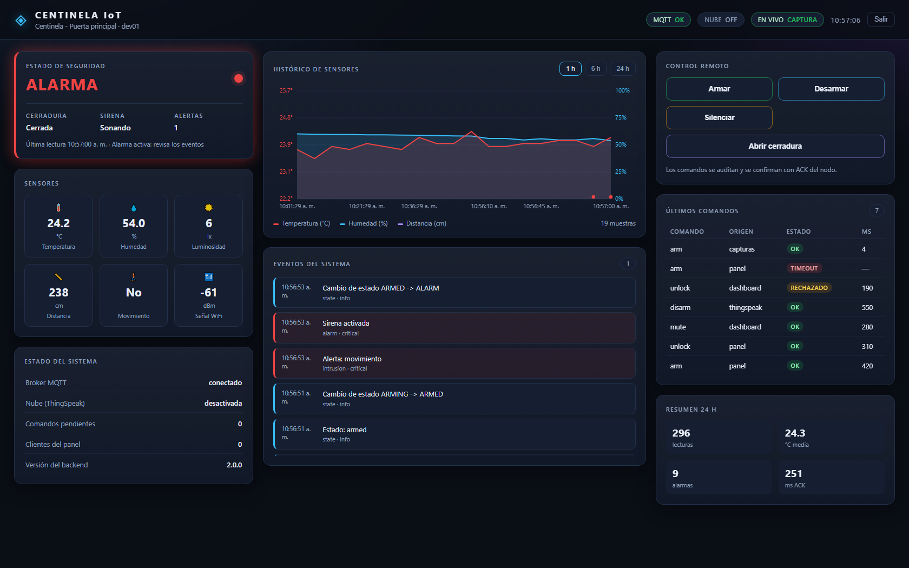
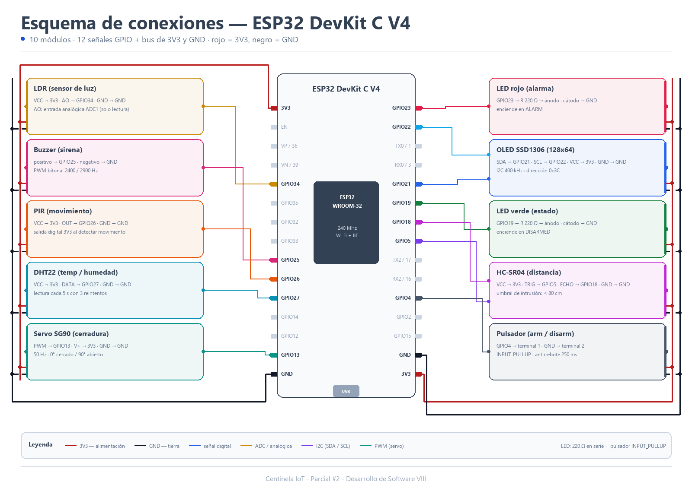

# Centinela IoT — Sistema de Seguridad con detección y alertas

[](https://github.com/1ault/ds8_p2/actions/workflows/tests.yml)
[](https://www.python.org/)
[](https://micropython.org/)

**Parcial #2 · Desarrollo de Software VIII · Sistema IoT de monitoreo y control inteligente**
Escenario 4: **Sistema de Seguridad — Detección y alertas**

**Repositorio:** <https://github.com/1ault/ds8_p2> · **Release:** <https://github.com/1ault/ds8_p2/releases/latest>

Sistema IoT completo: un nodo **ESP32** programado en **MicroPython** (simulado
en **Wokwi**) lee cuatro sensores de seguridad, decide con una máquina de
estados, acciona cinco actuadores y se comunica por **MQTT** con un **backend
en Python asíncrono** que guarda el histórico en **SQLite**, lo publica en
**ThingSpeak** y ofrece un **panel web en tiempo real** con control
bidireccional y comandos confirmados por *ACK*.



> **Puesta en marcha rápida:** backend + SQLite, Wokwi y ThingSpeak paso a
> paso en [`docs/instalacion.md`](docs/instalacion.md).

---

## 1. Qué hace el sistema

| # | Función | Dónde está |
|---|---------|-----------|
| 1 | Lee **4 sensores** (DHT22, PIR, HC-SR04, LDR) | `firmware/sensors.py` |
| 2 | Controla **5 actuadores** (2 LEDs, buzzer, servo-cerradura, OLED) | `firmware/actuators.py`, `display.py` |
| 3 | Máquina de estados de seguridad (desarmado → armando → armado → alarma) | `firmware/fsm.py` |
| 4 | Cliente **MQTT 3.1.1 propio** con QoS 0/1 y Last Will | `firmware/mqtt_client.py` |
| 5 | Guarda cada lectura **con timestamp** en SQLite | `backend/storage.py` |
| 6 | Registra **eventos** y **comandos** con ACK, latencia y motivo | `backend/commands.py` |
| 7 | Consultas de **históricos** (12 SQL + CLI + API) | `sql/consultas.sql`, `backend/cli.py` |
| 8 | Sube a **ThingSpeak** y recibe comandos por **TalkBack** | `backend/cloud.py` |
| 9 | **Panel en tiempo real** (SSE) con login y control remoto | `backend/web/` |
| 10 | Programación **modular y orientada a eventos** (asyncio + bus) | `firmware/app.py`, `backend/bus.py` |

---

## 2. Arquitectura

```
┌──────────────────────────────┐        ┌──────────────────────────┐
│ DISPOSITIVO                  │  MQTT  │ BROKER                   │
│ ESP32 + MicroPython (Wokwi)  │◄──────►│ HiveMQ                   │
│ 4 sensores · 5 actuadores    │        │ broker.hivemq.com:1883   │
│ asyncio + FSM + cliente MQTT │        │ centinela/dev01/#        │
└──────────────────────────────┘        └────────────┬─────────────┘
                                                     │
                                        ┌────────────▼─────────────┐
                                        │ BACKEND PYTHON (asyncio) │
                                        │ puente MQTT · comandos   │
                                        │ SQLite · API REST + SSE  │
                                        │ cliente ThingSpeak       │
                                        └────────────┬─────────────┘
                                                     │ HTTP / SSE
                                        ┌────────────▼─────────────┐
                                        │ USUARIO                  │
                                        │ panel web · ThingSpeak   │
                                        │ TalkBack (nube → nodo)   │
                                        └──────────────────────────┘
```

Diagramas detallados en [`docs/img/`](docs/img): arquitectura, flujo de datos,
circuito, máquina de estados y modelo de datos.
Explicación completa en [`docs/arquitectura.md`](docs/arquitectura.md).

---

## 3. Estructura del repositorio

```
Parcial2_IoT_Seguridad/
├── firmware/                  # nodo ESP32 (MicroPython) — se sube a Wokwi
│   ├── main.py                # punto de entrada
│   ├── config.py              # pines, umbrales, tiempos, tópicos
│   ├── hal.py                 # único módulo que toca `machine`
│   ├── bus.py                 # bus de eventos asíncrono
│   ├── fsm.py                 # máquina de estados (lógica pura)
│   ├── sensors.py             # DHT22, PIR, HC-SR04, LDR
│   ├── actuators.py           # LEDs, sirena PWM, servo-cerradura
│   ├── display.py             # interfaz local en el OLED
│   ├── ssd1306.py             # driver del OLED
│   ├── mqtt_client.py         # MQTT 3.1.1 propio sobre asyncio
│   ├── net.py                 # WiFi con reintentos
│   ├── app.py                 # controlador: tareas asíncronas
│   ├── diagram.json           # circuito de Wokwi
│   └── README_WOKWI.md        # cómo importar el proyecto
├── backend/                   # servidor Python
│   ├── main.py                # arranque y tareas de fondo
│   ├── config.py              # configuración por entorno
│   ├── mqtt_bridge.py         # paho-mqtt → asyncio
│   ├── storage.py             # DAO SQLite
│   ├── commands.py            # validación, envío y auditoría
│   ├── cloud.py               # ThingSpeak (canal + TalkBack)
│   ├── bus.py                 # eventos para SSE
│   ├── cli.py                 # consultas de históricos
│   └── web/                   # API REST, SSE, login y panel
├── sql/                       # schema.sql · seed.sql · consultas.sql
├── scripts/                   # demo, emulador, diagramas, capturas, empaquetado
├── tests/                     # 314 pruebas (pytest)
├── docs/                      # documentación, diagramas y capturas
├── entregables/               # ZIP de Wokwi, ZIP del proyecto y manifiesto
├── requirements.txt           # dependencias del backend
├── requirements-dev.txt       # pruebas y herramientas
├── .env.example               # plantilla de configuración
└── README.md
```

---

## 4. Circuito (ESP32 DevKit C V4)



| Componente | Pines | GPIO |
|------------|-------|------|
| DHT22 (temperatura/humedad) | VCC · SDA · GND | 3V3 · **27** · GND |
| PIR HC-SR501 (movimiento) | VCC · OUT · GND | 3V3 · **26** · GND |
| HC-SR04 (distancia) | VCC · TRIG · ECHO · GND | 3V3 · **5** · **18** · GND |
| LDR (luz) | VCC · AO · GND | 3V3 · **34** (ADC1) · GND |
| LED rojo (alarma) | ánodo · cátodo | **23** (vía 220 Ω) · GND |
| LED verde (normal) | ánodo · cátodo | **19** (vía 220 Ω) · GND |
| Buzzer pasivo (sirena) | + · − | **25** (PWM) · GND |
| Servo SG90 (cerradura) | PWM · V+ · GND | **13** · 3V3 · GND |
| OLED SSD1306 | SDA · SCL · VCC · GND | **21** · **22** · 3V3 · GND |
| Pulsador (armar/desarmar) | terminal 1 · 2 | **4** · GND |

> **Hardware real:** el HC-SR04 y el servo se alimentan a **5 V**, y el `ECHO`
> del HC-SR04 entrega 5 V → usar un divisor de tensión antes del GPIO18. El
> DHT22 necesita *pull-up* de 10 kΩ.

---

## 5. Tópicos MQTT

Prefijo configurable (`TOPIC_PREFIX`), dispositivo `dev01`:

| Tópico | Dirección | QoS | Contenido |
|--------|-----------|-----|-----------|
| `centinela/dev01/telemetry` | nodo → nube | 0 | lecturas de los 4 sensores |
| `centinela/dev01/events` | nodo → nube | 1 | alarmas, estados, red |
| `centinela/dev01/status` | nodo → nube | 1 retained | `online` / `offline` (LWT) |
| `centinela/dev01/cmd` | nube → nodo | 1 | comandos |
| `centinela/dev01/ack` | nodo → nube | 1 | confirmación con resultado |
| `centinela/dev01/config` | nube → nodo | 1 | cambio de umbrales en caliente |

Telemetría:

```json
{"v":1,"device":"dev01","seq":42,"uptime_s":210,
 "temp_c":24.6,"hum_pct":58.0,"lux":63.0,"dist_cm":118.0,
 "motion":false,"state":"ARMED","alarm":false,"siren":false,
 "locked":true,"alerts":2,"rssi":-55,"fw":"2.0.0"}
```

Comando y confirmación:

```json
{"v":1,"id":"9f2c1a7b3d40","cmd":"unlock","args":{"pin":"2468"},"source":"panel"}
{"v":1,"id":"9f2c1a7b3d40","cmd":"unlock","ok":true,"state":"DISARMED",
 "locked":false,"alerts":0,"result":{"locked":false,"auto_relock_s":8}}
```

Comandos admitidos: `arm`, `disarm`, `mute`, `unlock` (con PIN), `ping` y
`set_config` (umbrales).

---

## 6. Puesta en marcha

> Guía detallada, ThingSpeak y solución de problemas:
> [`docs/instalacion.md`](docs/instalacion.md).

### 6.1 Backend + SQLite (panel local)

```bat
git clone https://github.com/1ault/ds8_p2.git
cd ds8_p2
python -m venv venv
venv\Scripts\activate
pip install -r requirements.txt
python -m backend.main --seed
```

Abrir <http://127.0.0.1:8000> y entrar con `admin` / `seguridad2026`.
La base SQLite se crea sola en `data\centinela.db`; **no necesita cuenta**.
Consultas: `python -m backend.cli resumen`, `historico --horas 24`,
`eventos`, `comandos`, `estadisticas`.

### 6.2 Nodo en Wokwi web

1. <https://wokwi.com> → **New Project** → **ESP32 / MicroPython**.
2. Importar `Wokwi_Centinela_IoT.zip` desde el
   [Release](https://github.com/1ault/ds8_p2/releases/latest).
3. **Play**: se conecta a `Wokwi-GUEST`, publica telemetría cada 5 s y
   queda a la escucha de comandos. El OLED muestra estado y lecturas.

### 6.3 Nodo en VS Code (extensión de Wokwi)

1. Abrir la carpeta `firmware/` del repo en VS Code (o
   `entregables/Wokwi_Centinela_IoT` si tenés el paquete de entrega).
   Si usás el repo, descargá
   [`ESP32_GENERIC-20260824-v1.29.0.bin`](https://github.com/wokwi/wokwi-vscode-micropython/raw/main/esp32/ESP32_GENERIC-20260824-v1.29.0.bin)
   dentro de `firmware/`.
2. **F1** → `Wokwi: Request a new License` y `Wokwi: Start Simulator`
   (elegir `wokwi.toml`).
3. Con la simulación corriendo y visible, ejecutar `subir_a_wokwi.bat`.

`subir_a_wokwi.bat` **solo se usa con la extensión**: copia los 12 módulos
`.py` al MicroPython simulado con `mpremote` (puerto RFC2217 4000) y
reinicia la placa. No se usa en Wokwi web. El filesystem del simulador no es
persistente: hay que volver a ejecutarlo tras cada reinicio.

### 6.4 Demo completa sin Wokwi (recomendada para presentar)

```bat
python scripts\demo.py --reset --sembrar --sin-login
```

Arranca el backend con 24 h de histórico y un **nodo emulado que ejecuta el
código real del firmware** (FSM, controlador y cliente MQTT incluidos).
Con `--sin-mqtt` funciona sin Internet (transporte en memoria).

### 6.5 Pruebas

```bat
python -m pytest
```

**314 pruebas aprobadas** (~1 min): firmware con dobles de hardware y backend
contra SQLite real, un broker MQTT falso sobre TCP y el servidor aiohttp.

---

## 7. Panel del operador

| Sección | Contenido |
|---------|-----------|
| Estado de seguridad | estado actual, cerradura, sirena y número de alertas |
| Sensores | temperatura, humedad, luz, distancia, movimiento y señal WiFi |
| Histórico | gráfica de temperatura y humedad con rangos de 1 h / 6 h / 24 h |
| Eventos | feed en vivo con severidad y hora |
| Control remoto | armar, desarmar, silenciar y abrir cerradura con PIN |
| Últimos comandos | estado final (OK / RECHAZADO / TIMEOUT) y latencia |
| Estado del sistema | broker, nube, comandos pendientes y versión |

Detalles técnicos: [`docs/arquitectura.md`](docs/arquitectura.md).

---

## 8. Documentación

| Documento | Contenido |
|-----------|-----------|
| [`docs/manuales/Informe_Tecnico_Centinela_IoT.docx`](docs/manuales/) | informe técnico: objetivos, metodología, resultados y conclusiones (21 páginas) |
| [`docs/manuales/Manual_Tecnico_Centinela_IoT.docx`](docs/manuales/) | manual técnico: arquitectura, protocolo, servicios, operación (33 páginas) |
| [`docs/manuales/Manual_Usuario_Centinela_IoT.docx`](docs/manuales/) | manual del usuario: uso del panel y de las alertas (22 páginas) |
| [`docs/manuales/Documentacion_Extendida_Centinela_IoT.docx`](docs/manuales/) | anexo: catálogo de módulos con firmas y variables, código y SQL comentados, y cumplimiento (45 páginas) |
| [`docs/manuales/Guia_Prueba_Monitoreo.docx`](docs/manuales/) | guía práctica: arrancar la interfaz, comprobar que registra y consultar el histórico (12 páginas) |
| [`docs/manuales/Guia_Instalacion_Montaje.docx`](docs/manuales/) | instalación desde cero: entorno, configuración, Wokwi, montaje físico y ThingSpeak (20 páginas) |
| [`docs/arquitectura.md`](docs/arquitectura.md) | componentes, tópicos, FSM, decisiones de diseño |
| [`docs/flujo_datos.md`](docs/flujo_datos.md) | recorrido del dato y del comando, paso a paso |
| [`docs/plataforma_nube.md`](docs/plataforma_nube.md) | configuración de ThingSpeak y TalkBack |
| [`docs/base_datos.md`](docs/base_datos.md) | esquema, vistas, índices y consultas |
| [`docs/instalacion.md`](docs/instalacion.md) | instalación, problemas frecuentes, publicación |
| [`docs/guia_demo.md`](docs/guia_demo.md) | guion de la demostración y capturas |
| [`docs/checklist.md`](docs/checklist.md) | requisito del enunciado → dónde se cumple |

Diagramas: [`docs/img/`](docs/img) · Capturas reales: [`docs/capturas/`](docs/capturas).

---

## 9. Resiliencia y seguridad

- **Reconexión** con backoff exponencial en WiFi y MQTT; el nodo no se cae por
  perder la red.
- **Last Will**: si el ESP32 desaparece, el broker publica `offline` retenido.
- **Comandos auditados**: se guardan antes de enviarse y se marcan `TIMEOUT` si
  el nodo no confirma en 8 s.
- **Lista blanca** de comandos, validación de tipos y rangos, y límite de 30 por
  minuto.
- **PIN** para la cerradura, con bloqueo de 30 s tras tres intentos fallidos.
- **Sesión** con cookie firmada (HMAC-SHA256) y comparación en tiempo constante.
- **SQL parametrizado** en el 100 % de las consultas.
- **TLS** opcional para HiveMQ Cloud (`MQTT_TLS=1`, puerto 8883).

---

## 10. Entregables

En GitHub, el código, la documentación y las capturas están en el repositorio;
los **ZIP, PDF y el manifiesto** se descargan del
[Release `v2.0.0`](https://github.com/1ault/ds8_p2/releases/tag/v2.0.0) y se
adjuntan en Teams. No se versionan en el repositorio.

| Archivo | Contenido |
|---------|-----------|
| `entregables/Informe_Tecnico_Centinela_IoT.docx` / `.pdf` | informe técnico del proyecto |
| `entregables/Manual_Tecnico_Centinela_IoT.docx` / `.pdf` | manual técnico del sistema |
| `entregables/Manual_Usuario_Centinela_IoT.docx` / `.pdf` | manual del usuario |
| `entregables/Parcial2_IoT_Seguridad.zip` | proyecto completo (código, SQL, pruebas, documentación e imágenes) |
| `entregables/Wokwi_Centinela_IoT.zip` | proyecto para importar en wokwi.com |
| `entregables/LEEME_ENTREGA.md` | índice de la entrega y pasos antes de subir |
| `entregables/MANIFIESTO.txt` | tamaño y SHA-256 de cada archivo |

Se regeneran con:

```bat
python scripts\empaquetar.py        :: paquetes, documentos y manifiesto
python scripts\build_informe_tecnico.py  :: informe en Word
python scripts\generar_diagramas.py :: los 5 diagramas PNG
python scripts\capturar_dashboard.py:: capturas del panel y de la CLI
python scripts\capturar_wokwi.py --url <enlace del proyecto>  :: capturas del simulador
```

Capturas del simulador (proyecto público en Wokwi):
`docs/capturas/wokwi_01..05_*.png` — circuito, monitor serie y OLED en ARMADO y
ALARMA, tomadas del proyecto
<https://wokwi.com/projects/480692575433146369>.

---

## 11. Autoría y contexto académico

Proyecto desarrollado para el **Parcial #2** de *Desarrollo de Software VIII*
(Panamá). Escenario 4: *Sistema de Seguridad — Detección y alertas*.

- **Firmware**: MicroPython sobre ESP32 simulado en Wokwi, arquitectura
  asíncrona con máquina de estados pura.
- **Backend**: Python 3 con aiohttp, paho-mqtt, SQLite y asyncio.
- **Nube**: ThingSpeak (canal de 8 campos + TalkBack).
- **Pruebas**: 314 casos automatizados con pytest.

> Las capturas del simulador de Wokwi y del canal de ThingSpeak deben tomarlas
> con su propia cuenta; el guion está en [`docs/guia_demo.md`](docs/guia_demo.md).
