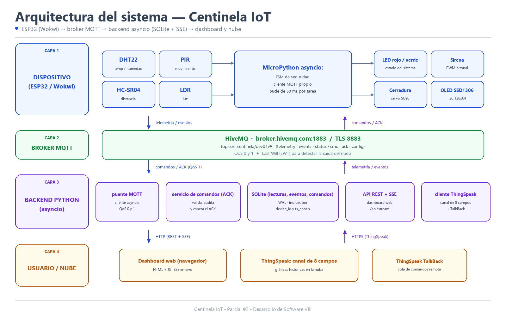
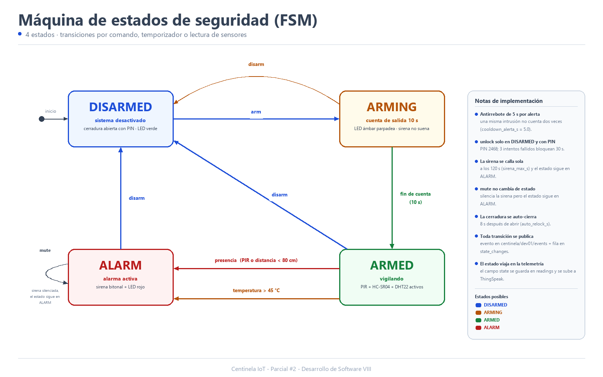

# Arquitectura del sistema

**Centinela IoT** es un sistema de seguridad residencial con detección y
alertas. Este documento describe las cuatro capas, cómo se comunican y por qué
está diseñado así.



---

## 1. Vista general

```
┌──────────────────────────────┐        ┌──────────────────────────┐
│ DISPOSITIVO                  │  MQTT  │ BROKER                   │
│ ESP32 + MicroPython (Wokwi)  │◄──────►│ HiveMQ                   │
│ 4 sensores · 5 actuadores    │        │ broker.hivemq.com:1883   │
│ asyncio + FSM de seguridad   │        │ centinela/dev01/#        │
└──────────────────────────────┘        └────────────┬─────────────┘
                                                     │
                                        ┌────────────▼─────────────┐
                                        │ BACKEND PYTHON (asyncio) │
                                        │ puente MQTT              │
                                        │ servicio de comandos     │
                                        │ SQLite (histórico)       │
                                        │ API REST + SSE           │
                                        │ cliente ThingSpeak       │
                                        └────────────┬─────────────┘
                                                     │ HTTP / SSE
                                        ┌────────────▼─────────────┐
                                        │ USUARIO                  │
                                        │ panel web del operador   │
                                        │ canal de ThingSpeak      │
                                        │ TalkBack (nube → nodo)   │
                                        └──────────────────────────┘
```

### Por qué hay un backend en medio

Podría pensarse que el ESP32 hable directo con ThingSpeak, pero se decidió lo
contrario por tres razones concretas:

1. **SQLite no cabe en el microcontrolador.** El enunciado pide histórico con
   *timestamp*, eventos y auditoría de comandos; eso vive en el servidor.
2. **Los comandos necesitan validación y auditoría.** El backend valida el
   comando, lo guarda *antes* de enviarlo y espera el ACK: si el nodo no
   responde, queda registrado como `TIMEOUT` en lugar de perderse.
3. **El panel debe seguir siendo útil si la nube falla.** El histórico local y
   la interfaz funcionan sin Internet; ThingSpeak es un extra, no una
   dependencia.

---

## 2. Capa de dispositivo (ESP32 / MicroPython)

### 2.1 Componentes

| Componente | Tipo | GPIO | Función |
|------------|------|------|---------|
| DHT22 | sensor digital | 27 | temperatura y humedad |
| PIR HC-SR501 | sensor digital | 26 | movimiento |
| HC-SR04 | sensor ultrasónico | TRIG 5 · ECHO 18 | distancia / presencia cercana |
| LDR (módulo) | sensor analógico | 34 (ADC1) | luminosidad en lux |
| LED rojo | actuador | 23 | indicador de alarma |
| LED verde | actuador | 19 | indicador de sistema normal |
| Buzzer pasivo | actuador PWM | 25 | sirena bitonal 2,4–2,9 kHz |
| Servo SG90 | actuador PWM | 13 | cerradura (0° cerrada, 90° abierta) |
| OLED SSD1306 | salida I2C | SDA 21 · SCL 22 | interfaz local |
| Pulsador | entrada | 4 | armar / desarmar |

### 2.2 Organización del código

El firmware son 12 módulos con una única responsabilidad cada uno:

| Módulo | Responsabilidad |
|--------|-----------------|
| `main.py` | arranque: pantalla, WiFi, componentes, controlador |
| `config.py` | pines, umbrales, tiempos, tópicos, credenciales |
| `hal.py` | **único** punto que toca `machine` (Pin, PWM, ADC, I2C, DHT) |
| `bus.py` | bus de eventos asíncrono con buzones acotados |
| `fsm.py` | máquina de estados pura (sin hardware ni red) |
| `sensors.py` | DHT22, PIR, HC-SR04 y LDR con validación y mediana |
| `actuators.py` | LEDs, sirena PWM y cerradura con servo |
| `ssd1306.py` | driver mínimo del OLED sobre `framebuf` |
| `display.py` | interfaz local: estado, lecturas y enlace |
| `mqtt_client.py` | cliente MQTT 3.1.1 propio sobre `asyncio` streams |
| `net.py` | WiFi con reintentos y estado de la señal |
| `app.py` | controlador: tareas asíncronas y aplicación de efectos |

La separación `hal.py` (hardware) ↔ `fsm.py` (lógica) es lo que permite probar
309 casos en CPython sin placas ni simulador.

### 2.3 Concurrencia: tareas asíncronas cooperativas

No hay `while True` bloqueantes ni `sleep` largos. El controlador lanza siete
tareas independientes y todas comparten un único bucle de eventos:

| Tarea | Periodo | Qué hace |
|-------|---------|----------|
| `_bucle_mqtt` | evento | conecta, se suscribe y vigila la caída del enlace |
| `_bucle_sensores` | 50 ms | lee sensores, avanza la FSM y aplica efectos |
| `_bucle_telemetria` | 5 s | publica el estado de los sensores |
| `_bucle_leds` | 100 ms | parpadeos y tono bitonal de la sirena |
| `_bucle_pantalla` | 600 ms | refresca el OLED |
| `_bucle_comandos` | evento | procesa comandos llegados del bus |
| `_bucle_boton` | 50 ms | antirrebote del pulsador físico |

Una lectura lenta del DHT22 (hasta ~30 ms) no retrasa la vigilancia del PIR,
porque el sensor tiene su propio periodo y su propio hueco en el bucle.

---

## 3. Máquina de estados de seguridad



| Estado | Significado | Sirena | Cerradura |
|--------|-------------|--------|-----------|
| `DISARMED` | sistema desactivado | no | se puede abrir con PIN |
| `ARMING` | cuenta regresiva de salida (10 s) | no | cerrada |
| `ARMED` | vigilando | no | cerrada |
| `ALARM` | intrusión confirmada | sí | cerrada |

Reglas implementadas:

- Solo se puede abrir la cerradura en `DISARMED` y con el PIN correcto.
- Tres PIN erróneos bloquean el comando 30 s.
- La cerradura se cierra sola 8 s después de abrirse.
- La sirena se calla sola a los 120 s si nadie desarma.
- Una alerta nueva necesita 5 s de separación (antirrebote): un PIR que queda
  en alto varios segundos no genera decenas de alertas.
- El estado se publica por evento y se guarda en la tabla `state_changes`.

La FSM **no** toca hardware: devuelve una lista de efectos (`sirena_on`,
`abrir_cerradura`, `registrar_alerta`, …) que el controlador traduce a GPIO y a
mensajes MQTT. Por eso se puede probar entera con 39 casos automáticos.

---

## 4. Capa de transporte: MQTT

### 4.1 Tópicos

Prefijo `centinela`, dispositivo `dev01`:

| Tópico | Dirección | QoS | Contenido |
|--------|-----------|-----|-----------|
| `centinela/dev01/telemetry` | nodo → nube | 0 | lecturas de los 4 sensores |
| `centinela/dev01/events` | nodo → nube | 1 | alarmas, cambios de estado, red |
| `centinela/dev01/status` | nodo → nube | 1 (retain) | `online` / `offline` (LWT) |
| `centinela/dev01/cmd` | nube → nodo | 1 | comandos |
| `centinela/dev01/ack` | nodo → nube | 1 | confirmación con resultado |
| `centinela/dev01/config` | nube → nodo | 1 | umbrales en caliente |

El backend se suscribe con el comodín `centinela/+/#`, de modo que admite
varios dispositivos sin cambiar código.

### 4.2 Ejemplo de telemetría

```json
{
  "v": 1, "device": "dev01", "name": "Centinela-Puerta-Principal",
  "seq": 42, "uptime_s": 210,
  "temp_c": 24.6, "hum_pct": 58.0, "lux": 63.0, "dist_cm": 118.0,
  "motion": false, "state": "ARMED", "alarm": false, "siren": false,
  "locked": true, "alerts": 2, "rssi": -55,
  "sensor_errors": 0, "fw": "2.0.0"
}
```

### 4.3 Comando y confirmación

```json
{"v":1,"id":"9f2c1a7b3d40","cmd":"unlock","args":{"pin":"2468"},"source":"panel"}
{"v":1,"id":"9f2c1a7b3d40","cmd":"unlock","ok":true,"state":"DISARMED",
 "locked":false,"alerts":0,"result":{"locked":false,"auto_relock_s":8}}
```

### 4.4 Cliente MQTT propio

`mqtt_client.py` implementa MQTT 3.1.1 sobre `asyncio.open_connection`:
CONNECT con Last Will, SUBSCRIBE/SUBACK, PUBLISH QoS 0 y 1 con PUBACK,
PINGREQ/PINGRESP y reconexión con backoff. La primera mitad del módulo son
funciones puras de codificación, probadas byte a byte contra un broker falso
que habla TCP real.

No se usó una librería porque **no existen clientes MQTT para MicroPython** en
el ESP32 simulado; escribirlo era requisito, no capricho.

---

## 5. Capa de servicios: backend Python

```
backend/
├── main.py          compone servicios y tareas de fondo
├── config.py        configuración por entorno / .env
├── mqtt_bridge.py   paho-mqtt (hilo) → cola asyncio
├── storage.py       DAO SQLite con un único escritor
├── commands.py      validación, envío, ACK y auditoría
├── cloud.py         ThingSpeak: canal de 8 campos y TalkBack
├── bus.py           eventos en proceso para SSE
├── web/app.py       API REST, SSE, login y estáticos
├── web/auth.py      cookie de sesión firmada con HMAC
└── cli.py           consultas de históricos por consola
```

Decisiones relevantes:

- **paho-mqtt en un hilo, adaptado a asyncio.** paho es el estándar de facto y
  está mantenido; se usa `connect_async` + `loop_start()` y los callbacks
  depositan en una `asyncio.Queue` con `call_soon_threadsafe`. El resto del
  backend nunca ve hilos.
- **Un solo escritor en SQLite.** Todas las escrituras pasan por un
  `asyncio.Lock` y un `to_thread`; se activa WAL. Así se evita el clásico
  `database is locked` sin renunciar a SQLite.
- **SSE en lugar de WebSocket.** Un solo sentido, reconexión nativa del
  navegador y cero dependencias adicionales.
- **Aiohttp en lugar de Flask.** El panel y el puente MQTT comparten un único
  bucle de eventos: no hay servidor bloqueante ni hilos extra.

---

## 6. Seguridad

| Riesgo | Mitigación |
|--------|------------|
| Comando arbitrario por MQTT | lista blanca + validación de tipos y rangos |
| Abuso de comandos | límite de 30 por minuto |
| PIN por fuerza bruta | 3 intentos y bloqueo de 30 s (en el nodo) |
| Comando perdido | QoS 1 + ACK + estado `TIMEOUT` a los 8 s |
| Acceso al panel | cookie firmada con HMAC-SHA256, 8 h de validez |
| Comparación de credenciales | `hmac.compare_digest` (tiempo constante) |
| Inyección SQL | 100 % de consultas parametrizadas |
| Dispositivo suplantado | LWT retained: `offline` al caer el enlace |

---

## 7. Limitaciones conocidas

- El nodo no tiene reloj real (no usa NTP): publica `uptime_s` y es el
  **servidor** el que pone el `timestamp` de cada lectura.
- El broker público de HiveMQ no exige autenticación. Para producción hay que
  usar HiveMQ Cloud con TLS y credenciales (`MQTT_TLS=1`).
- El histórico crece ~17 000 filas al día con telemetría cada 5 s; la purga
  automática conserva 30 días por defecto (`RETENTION_DAYS`).
