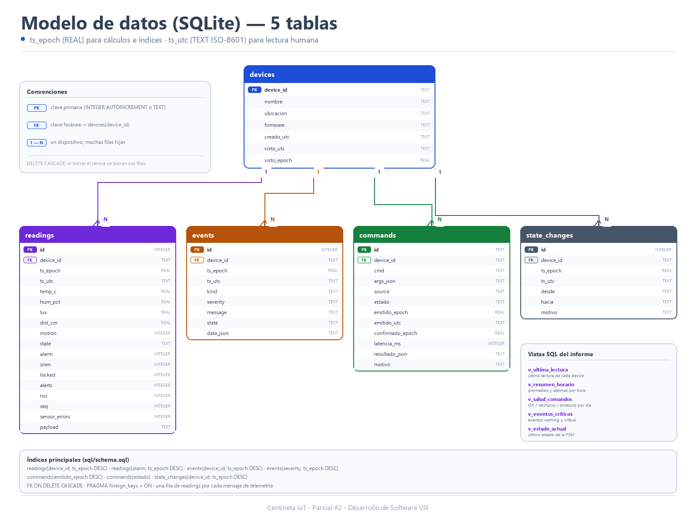

# Base de datos

Motor: **SQLite 3** en modo WAL. El esquema vive en [`sql/schema.sql`](../sql/schema.sql)
y el backend lo aplica al arrancar (es idempotente, se puede ejecutar varias
veces sin efectos secundarios).



---

## 1. Tablas

### `devices` — nodos registrados

| Columna | Tipo | Notas |
|---------|------|-------|
| `device_id` | TEXT PK | identificador del nodo (`dev01`) |
| `nombre` | TEXT | nombre legible |
| `ubicacion` | TEXT | dónde está instalado |
| `firmware` | TEXT | versión que reporta |
| `creado_utc` | TEXT | alta del dispositivo |
| `visto_utc` / `visto_epoch` | TEXT / REAL | última vez que se supo de él |

### `readings` — lecturas de sensores

Una fila por mensaje de telemetría. Columnas principales: `ts_epoch` (REAL),
`ts_utc` (TEXT ISO-8601), `temp_c`, `hum_pct`, `lux`, `dist_cm`, `motion`,
`state`, `alarm`, `siren`, `locked`, `alerts`, `rssi`, `seq`,
`sensor_errors` y `payload` (JSON original, para auditoría).

Restricciones: `state` solo admite `DISARMED`, `ARMING`, `ARMED`, `ALARM` o
`DESCONOCIDO`; `motion` y `alarm` son 0/1.

### `events` — eventos del sistema

`kind` (intrusion, alarm, state, network, command…), `severity`
(`info`/`warning`/`critical`), `message`, `state` y `data_json` con el detalle.

### `commands` — comandos y su resultado

`id` (12 hex), `cmd`, `args_json`, `source` (panel, thingspeak, boton, demo),
`estado` (`PENDIENTE`, `OK`, `RECHAZADO`, `TIMEOUT`, `ERROR`), marcas de
emisión y confirmación, `latencia_ms`, `resultado_json` y `motivo`.

### `state_changes` — historial de la FSM

`desde`, `hacia` y `motivo` de cada transición de seguridad.

---

## 2. Vistas

| Vista | Para qué sirve |
|-------|----------------|
| `v_ultima_lectura` | estado actual de cada dispositivo |
| `v_resumen_horario` | promedios, mínimos y máximos por hora |
| `v_salud_comandos` | porcentaje de éxito y latencia por origen y día |
| `v_eventos_criticos` | eventos `warning` y `critical` ordenados |
| `v_estado_actual` | última transición de estado por dispositivo |

---

## 3. Índices

```sql
idx_readings_device_ts   (device_id, ts_epoch DESC)   -- histórico y última lectura
idx_readings_alarm       (alarm, ts_epoch DESC)       -- episodios de alarma
idx_events_device_ts     (device_id, ts_epoch DESC)   -- feed de eventos
idx_events_severity      (severity, ts_epoch DESC)    -- filtro de críticos
idx_commands_emitido     (emitido_epoch DESC)         -- tabla de comandos
idx_commands_estado      (estado)                     -- pendientes/timeouts
idx_state_device_ts      (device_id, ts_epoch DESC)   -- transiciones
```

---

## 4. Consultas de históricos

Las 12 consultas documentadas están en [`sql/consultas.sql`](../sql/consultas.sql)
y se pueden ejecutar directamente con `sqlite3`. Las más usadas tienen su
equivalente en la CLI:

| Necesidad | SQL | CLI |
|-----------|-----|-----|
| Última lectura | consulta 01 | `python -m backend.cli resumen` |
| Histórico de N horas | consulta 02 | `python -m backend.cli historico --horas 6` |
| Tendencia por hora | consulta 03 | `python -m backend.cli agregado --horas 24` |
| Eventos críticos | consulta 04 | `python -m backend.cli eventos --severidad critical` |
| Comandos y latencias | consulta 05 | `python -m backend.cli comandos` |
| Salud por origen | consulta 06 | — |
| Transiciones | consulta 07 | `python -m backend.cli cambios` |
| Rango térmico diario | consulta 08 | — |
| Actividad por hora | consulta 09 | — |
| Episodios de alarma | consulta 10 | — |
| Huecos de telemetría | consulta 11 | — |
| Volumen por tabla | consulta 12 | — |

Ejemplo de la consulta 11 (detectar caídas del nodo):

```sql
SELECT ts_utc, ROUND(siguiente - ts_epoch, 1) AS segundos_sin_datos
  FROM (SELECT ts_epoch, ts_utc,
               LEAD(ts_epoch) OVER (ORDER BY ts_epoch) AS siguiente
          FROM readings WHERE device_id = :device_id)
 WHERE siguiente - ts_epoch > 30
 ORDER BY ts_epoch DESC LIMIT 20;
```

---

## 5. Datos de demostración

`sql/seed.sql` inserta 24 horas de lecturas (una cada 5 minutos, 288 filas),
7 eventos, 6 comandos en distintos estados y 3 transiciones. Se carga con:

```bat
python -m backend.main --seed
python scripts\demo.py --reset --sembrar
```

---

## 6. Operación y mantenimiento

| Tarea | Cómo |
|-------|------|
| Crear la base desde cero | `sqlite3 data/centinela.db < sql/schema.sql` |
| Ver el esquema | `sqlite3 data/centinela.db ".schema"` |
| Tamaño y filas | `sqlite3 data/centinela.db "VACUUM; ANALYZE;"` |
| Purgar datos viejos | `python -m backend.cli purgar --dias 30` |
| Compactar | `sqlite3 data/centinela.db "VACUUM;"` |

Crecimiento estimado con telemetría cada 5 s: unas 17 000 filas y ~1,5 MB al
mes. La purga automática del backend conserva 30 días (`RETENTION_DAYS`).

### Concurrencia

SQLite no admite varias escrituras a la vez. El backend serializa todas las
escrituras con un `asyncio.Lock` y las ejecuta en un hilo aparte, con
`journal_mode=WAL`, `synchronous=NORMAL` y `foreign_keys=ON`. Con ese diseño el
panel puede leer mientras se escribe sin `database is locked`.
