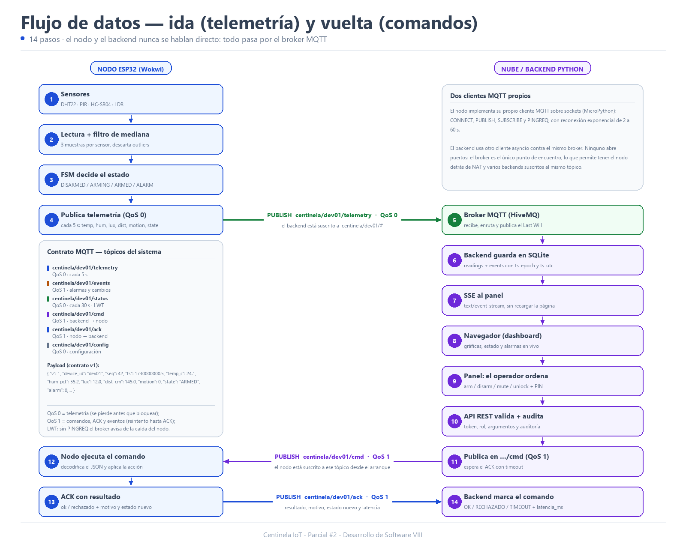

# Flujo de datos

Este documento sigue el recorrido completo de un dato, desde que el sensor lo
produce hasta que el operador lo ve en el panel, y el camino de vuelta de un
comando hasta su confirmación.



---

## 1. Camino de subida: del sensor al panel

| # | Paso | Dónde ocurre | Detalle |
|---|------|--------------|---------|
| 1 | Lectura del sensor | `firmware/sensors.py` | cada sensor tiene su periodo: PIR 150 ms, distancia 500 ms, luz 1 s, DHT22 5 s |
| 2 | Filtrado y validación | `sensors.py` | mediana de 3 muestras, rangos físicos y descarte de lecturas imposibles |
| 3 | Decisión de seguridad | `firmware/fsm.py` | la presencia solo alerta en `ARMED`, con antirrebote de 5 s |
| 4 | Aplicación de efectos | `firmware/app.py` | LEDs, sirena, cerradura y eventos |
| 5 | Publicación de telemetría | `mqtt_client.py` | `centinela/dev01/telemetry`, QoS 0, cada 5 s |
| 6 | Reparto por el broker | HiveMQ | el backend está suscrito a `centinela/+/#` |
| 7 | Recepción y decodificación | `backend/mqtt_bridge.py` | paho en un hilo → cola asíncrona |
| 8 | Persistencia con timestamp | `backend/storage.py` | `INSERT` parametrizado en SQLite, hora del servidor |
| 9 | Notificación al panel | `backend/bus.py` | evento `lectura` a todos los suscriptores SSE |
| 10 | Pintado en el navegador | `backend/web/static/app.js` | actualiza KPIs y redibuja la gráfica |

### Por qué el timestamp lo pone el servidor

El ESP32 no tiene reloj de tiempo real ni NTP configurado: publica `uptime_s`.
Si el nodo pusiera la hora, cada reinicio rompería el histórico. El backend
sella cada lectura con `ts_epoch` (REAL, para cálculos) y `ts_utc` (ISO-8601,
para lectura humana) en el momento de recibirla.

### Qué pasa si el enlace se cae

1. El nodo detecta el fallo en la lectura o en el keepalive.
2. El broker publica el **Last Will** retenido: `centinela/dev01/status = offline`.
3. El backend recibe `offline` y lo registra; el panel lo muestra en la píldora
   MQTT.
4. Ambas partes reintentan con backoff exponencial (2 s → 60 s).
5. Al volver, el nodo se resuscribe solo y publica `online` (retenido).

---

## 2. Camino de bajada: del panel al actuador

| # | Paso | Dónde ocurre | Detalle |
|---|------|--------------|---------|
| 1 | El operador pulsa **Armar** | panel | `POST /api/comando` con `{cmd, args}` |
| 2 | Validación | `backend/commands.py` | lista blanca, tipos, rangos y límite de 30/min |
| 3 | Auditoría previa | `storage.py` | fila en `commands` con estado `PENDIENTE` |
| 4 | Publicación | `mqtt_bridge.py` | `centinela/dev01/cmd`, QoS 1 |
| 5 | Recepción en el nodo | `mqtt_client.py` | PUBACK al broker y callback al bus |
| 6 | Procesamiento | `firmware/app.py` | `procesar_comando` → FSM → efectos |
| 7 | Ejecución física | `actuators.py` | sirena, cerradura, LEDs |
| 8 | Confirmación | `mqtt_client.py` | `centinela/dev01/ack`, QoS 1, con `id` y `ok` |
| 9 | Cierre del comando | `commands.py` | `OK` o `RECHAZADO`, latencia en ms |
| 10 | Actualización del panel | SSE `comando` | insignia con el resultado |

Si el ACK no llega en 8 segundos, el comando se marca `TIMEOUT` y queda en la
tabla: el operador ve que no se ejecutó, en lugar de suponerlo.

### Correlación por identificador

Cada comando lleva un `id` de 12 caracteres hexadecimales generado en el
backend. El nodo lo devuelve intacto en el ACK. El servicio mantiene un
diccionario `id → future`; cuando el ACK entra, resuelve la espera y libera la
petición HTTP que estaba bloqueada. Los ACK con identificadores desconocidos se
descartan (defensa contra respuestas falsas).

---

## 3. Flujo hacia la nube (ThingSpeak)

```
lectura ──► ¿hay claves? ──no──► se ignora (modo local)
                 │ sí
                 ▼
        ¿pasaron 20 s? ──no──► se omite (omitidos++)
                 │ sí
                 ▼
   POST /update con 8 campos ──► 200 y entry id ──► enviados++
                 │ error
                 ▼
             errores++ y se registra el motivo
```

Y en sentido contrario:

```
cada 15 s ──► GET TalkBack /commands/execute.json
                    │ hay comando
                    ▼
        parsear "arm" / "unlock:2468" ──► servicio de comandos
                    │
                    ▼
        se publica en .../cmd y sigue el flujo normal con ACK
```

---

## 4. Resumen visual del contrato MQTT

| Tópico | Dirección | QoS | Frecuencia |
|--------|-----------|-----|------------|
| `centinela/dev01/telemetry` | nodo → backend | 0 | 5 s |
| `centinela/dev01/events` | nodo → backend | 1 | al ocurrir |
| `centinela/dev01/status` | nodo → backend | 1 retained | al conectar / LWT |
| `centinela/dev01/cmd` | backend → nodo | 1 | bajo demanda |
| `centinela/dev01/ack` | nodo → backend | 1 | tras cada comando |
| `centinela/dev01/config` | backend → nodo | 1 | bajo demanda |

QoS 0 para telemetría porque una lectura perdida se recupera en la siguiente;
QoS 1 para eventos, comandos y ACK porque perderlos cambia el estado del
sistema.
